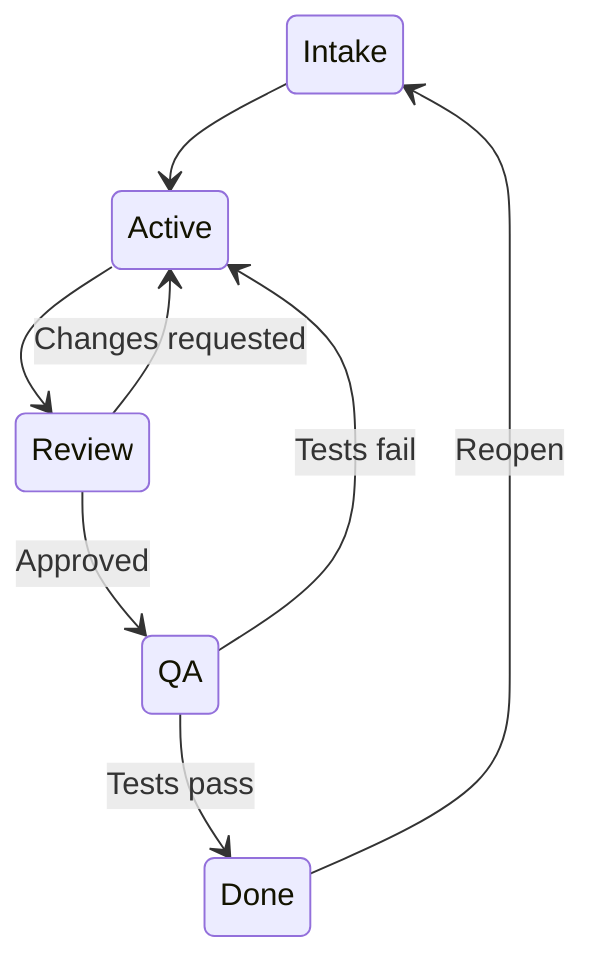

# Jira reference and WeftTrack roadmap

Official sources checked November 24, 2026. Example records below are illustrative. Atlassian controls plan entitlements and rollout timing.

## 1. Product and roles

Jira Cloud combines the former Jira Software Cloud and Jira Work Management products for technical and business teams. In Jira Cloud, a **space** was previously called a **project**, and a **work item** was previously called an **issue**. Older URLs, JQL fields, REST endpoints, and Jira Software Data Center documentation still use older terms. [Unification FAQ](https://www.atlassian.com/licensing/jira-work-management) · [Cloud release notes](https://confluence.atlassian.com/cloud/blog/2026/09/atlassian-cloud-changes-sep-7-to-sep-14-2026)

For a SaaS CSV export launch, a business user submits a request, a product manager prioritizes it, the team lead sequences work, a developer links code and reviews, and an admin governs access and workflow. Jira Service Management serves request portals, queues, SLAs, and incidents. Jira Product Discovery prioritizes ideas and connects them to delivery. Confluence holds specs and decisions, while Bitbucket holds code and pull requests. Check Atlassian collections and separate app entitlements when provisioning access. [Jira Cloud documentation](https://support.atlassian.com/jira-software-cloud/) · [Jira pricing](https://www.atlassian.com/software/jira/pricing)

## 2. Structure and example records

An organization manages accounts and sites. A site hosts Jira spaces, which contain work items and their settings. A typical hierarchy is epic → story, task, or bug → subtask. A parent expresses decomposition, while a work item link expresses another relationship such as blocking. Extra hierarchy levels depend on plan and configuration. A readable key such as EXPORT-12 is useful to people and integrations. Preserve the system ID when moving work or tracking a key change.

| Record | Example |
|---|---|
| Epic | EXPORT-1 Self-service export |
| Story | EXPORT-12 Download filtered results |
| Subtask | EXPORT-13 Test empty exports |
| Bug | EXPORT-15 Escape embedded quotes |
| Version | 1.4 |
| Component | Reporting |
| Label | accessibility |

Use priority for urgency, assignee for responsibility, watchers for updates, comments and mentions for discussion, attachments for evidence, and activity history to see edits. Company-managed spaces use administrator-managed configuration schemes that can be shared. Team-managed spaces give local administrators more control with settings scoped to their space. To migrate, map statuses, fields, work types, permissions, and board behavior before moving records. [Managed space comparison](https://support.atlassian.com/jira-software-cloud/docs/what-are-team-managed-and-company-managed-spaces/) · [Jira Cloud documentation](https://support.atlassian.com/jira-software-cloud/)

## 3. Daily use and permissions

Start with a space template and create EXPORT-12 with acceptance criteria. Assign it, link the bug as a blocker, mention QA in a comment, then follow the activity history. Clone it for a related request and check which fields and links copied. Move it when another space owns delivery, mapping work type and status and checking the new key. Use search to isolate a batch before using bulk edit. Save that search as a filter, share it with the team, and add it to a dashboard or board. Notification delivery depends on event configuration, recipients, and user settings.

| Action | Access to check |
|---|---|
| View | App access, space visibility, and work item security |
| Create, edit, assign | Corresponding space permissions and assignee eligibility |
| Transition | Transition permission and workflow rules |
| Move | Move access in the source and creation access in the destination |
| Bulk edit | Global bulk-change permission and permission for each underlying edit |

When access is missing, the item can be absent from search or the action can be hidden or rejected. Sharing a filter cannot grant access to its results. [Jira Cloud documentation](https://support.atlassian.com/jira-software-cloud/)

## 4. Workflows and configuration



A status is a workflow state. Its category groups it under To Do, In Progress, or Done. A transition is the allowed action between states. Resolution is a separate field. Configure the completion transition to set it and reopening to clear it where applicable. A Done item with an empty resolution can still match an unresolved JQL filter.

In a company-managed test space, draft the workflow, add a review condition and acceptance-criteria validator, configure a QA exception path, test with each role, then publish and map any removed statuses. Add fields to applicable screens, use layouts to organize the work item view, use field configurations to control required or hidden fields, and restrict custom field contexts to the relevant space and work types. Check every space attached to a shared scheme before publishing. Formal approvals depend on the app, plan, and configuration. [Jira Cloud documentation](https://support.atlassian.com/jira-software-cloud/)

## 5. Planning and reporting

Use a Scrum backlog to order work by rank, estimate the export story, and select sprint scope. On a Kanban board, pull it through columns under work-in-progress limits. Map statuses to columns, use swimlanes to group work, and add a quick filter for the Reporting component. Use timelines and dependency links to surface blocked work. Advanced cross-team planning and capacity depend on plan. Associate completed work with version 1.4 and verify open blockers before release.

Burndown tracks remaining sprint work against time, with scope changes affecting the curve. Velocity compares committed and completed estimates across sprints. Cumulative flow shows the number of items in each mapped column over time, with widening bands signaling accumulation. A control chart derives cycle time from time spent in selected workflow stages. Check board filters, status mappings, estimates, late scope additions, and reopened items before interpreting metrics. [Jira Cloud documentation](https://support.atlassian.com/jira-software-cloud/)

## 6. Search and JQL

Basic search uses graphical filters. JQL combines fields, operators, functions, and sort clauses. These examples use native Jira Cloud JQL and assume visible sample records, space EXPORT, and the named statuses, fields, or version where relevant. A Marketplace app may add its own functions, which require the app. Save frequently used queries, manage viewer and editor access to the filter, use it in dashboard gadgets, subscribe where available, and export permitted results. [JQL fields](https://support.atlassian.com/jira-software-cloud/docs/jql-fields/)

| Query | Result and prerequisite |
|---|---|
| `project = EXPORT` | All visible work in space EXPORT. The JQL field uses the older term. |
| `key = EXPORT-12` | One record by readable key. |
| `project = EXPORT AND issuetype = Bug` | Bugs in the space, assuming the work type is named Bug. |
| `assignee = currentUser()` | Work assigned to the signed-in caller. |
| `assignee IS EMPTY` | Unassigned work. |
| `resolution IS EMPTY AND statusCategory = Done` | Done-category work missing a resolution. |
| `created >= startOfWeek()` | Work created since the start of the current week. |
| `updated >= -7d ORDER BY updated DESC` | Recently updated work with newest updates first. |
| `project = EXPORT AND (priority = High OR labels = accessibility)` | High-priority or accessibility-labeled work within EXPORT. |
| `project = EXPORT AND fixVersion = "1.4"` | Work targeted at the configured version. |
| `sprint in openSprints()` | Work in active sprints, assuming Scrum sprint data. |
| `issue in linkedIssues("EXPORT-12")` | Work items linked to EXPORT-12 through native work item links. |

## 7. Automation and integrations

Give each rule a trigger, conditions, and actions. A work-created rule can assign Reporting items to triage. A status-transition rule can branch to related work and flag a blocker for review. A version-release rule can notify the release channel via a configured connection. Smart values supply event data, such as `{{issue.key}}`. Check rule scope, actor permissions, quota, and audit log when actions fail. Add conditions that prevent repeat writes and check whether a rule is allowed to trigger other rules.

Bitbucket and GitHub use development integrations to associate branches, commits, and pull requests with keys such as EXPORT-12. Confluence can contextualize the requirements and Jira records. Slack and Teams require configured integrations to send notifications or create work. Additional connectors and capabilities can require Marketplace apps or separate product access. [Jira Cloud documentation](https://support.atlassian.com/jira-software-cloud/) · [Jira pricing](https://www.atlassian.com/software/jira/pricing)

## 8. Governance

Check identity and app access first, then roles and groups, the space permission scheme, and work item security. A contractor can have Browse access in EXPORT and still be unable to see EXPORT-15 if its security level excludes them. Check the exact account and group membership before changing a shared scheme. Audit administrative changes and automation runs in their respective logs. Evaluate plan and deployment requirements for data residency, retention, backups, exports, and external collaborators. SSO and SCIM can depend on Atlassian Guard or an applicable entitlement. [Jira pricing](https://www.atlassian.com/software/jira/pricing) · [Jira Cloud documentation](https://support.atlassian.com/jira-software-cloud/)

## 9. Deployment and APIs

Atlassian operates Cloud. Jira Software Data Center is self-managed and covered by the announced March 28, 2029 end-of-life. Atlassian lists separate treatment for Bitbucket Data Center. Before migration, inventory identities, custom fields, workflows, permissions, integrations, and Marketplace data. Test mappings and validate counts and permissions after a trial migration. [Data Center lifecycle](https://www.atlassian.com/licensing/data-center-end-of-life)

Cloud integrations can use REST, OAuth or supported token-based authentication, webhooks, and Forge. Verify service-account access and token scopes, paginate according to the endpoint, and handle rate-limit responses and webhook re-delivery. Data Center has its own API and app compatibility. Example Cloud request with placeholders:

```sh
curl --user 'EMAIL:API_TOKEN' \
  'https://SITE.atlassian.net/rest/api/3/issue/EXPORT-12?fields=summary,status'
```

[Cloud REST API](https://developer.atlassian.com/cloud/jira/platform/rest/v3/intro/)

## 10. Plans and adoption

Cloud plan snapshot, November 24, 2026. Use the live calculator for regional prices, user tiers, and monthly or annual billing. Check quota definitions in the plan you intend to buy.

| Plan | Adoption considerations |
|---|---|
| Free | Up to 10 users, with limited storage, permissions, and automation. |
| Standard | Paid team plan with greater storage, permissions, and support. |
| Premium | Adds advanced planning and higher service and automation entitlements. |
| Enterprise | Adds enterprise administration and scale features. Confirm quote and collection requirements. |

[Jira pricing and limits](https://www.atlassian.com/software/jira/pricing)

A small team can start with a local workflow and shared board. An organization standardizing across teams should assign owners to schemes, reports, and integrations and pilot changes before rolling them out. For the export launch, verify that QA can see the work item, the PR appears in development information, the report counts completion, and the release notification reaches its destination.

## Glossary

- **Space** — container for work and configuration, formerly project.
- **Work item** — tracked record, formerly issue.
- **Scheme** — reusable mapping of settings for company-managed spaces.
- **Resolution** — recorded outcome used by filters and reports.
- **JQL** — Jira Query Language.
- **Graph edge** — a typed relationship between records.

## Setup checklist

1. Choose a deployment and plan, then assign configuration owners.
2. Create the space, configure work types and permissions, and test with actual roles.
3. Publish and test the workflow, including reopening.
4. Set up board filters, reports, and the release version.
5. Configure the code and messaging integrations and test as their service identities.

## Troubleshooting

| Symptom | Check first |
|---|---|
| Missing work item | Browse and work item security, then board filter and status mapping |
| Incorrect sprint report | Sprint dates, board scope, estimate changes, and done-column mapping |
| Done but unresolved | Resolution-setting and reopening rules |
| No notification | Event, recipient, user settings, and integration access |
| Failed automation | Audit log, actor access, rule scope, and remaining quota |
| Missing PR link | Repository connection, work item key, and integration access |

## WeftTrack implementation sequence

The prototype implements work creation, status transitions, external change identity, and typed graph links. Next, add spaces and work types, authentication and visibility, work item history, board and graph views, then filters, reports, and automation. Treat Jira APIs and imports as adapters. Use the companion contract in the README to connect code changes while preserving identifiers and permissions across repositories.
