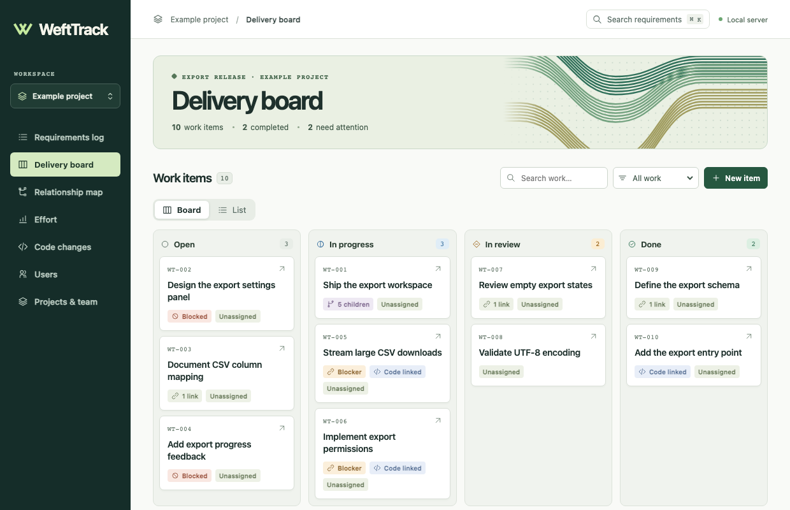
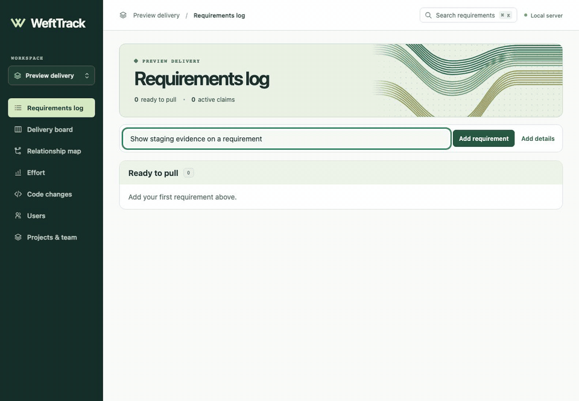

# WeftTrack

A local-first work tracker for people and coding agents. Capture a requirement, see what blocks it, and claim the next item you can start. The review stays linked to the requirement and the code that implements it.

[Quickstart](#quickstart) · [Using the queue](#using-the-queue) · [Agent CLI](#agent-cli) · [JSON API](#json-api) · [Tests](#tests)



<details>
<summary>Watch a requirement reach staging (28 seconds)</summary>



The recording follows two local apps from the original requirement to the exact commit behind **Open site**. The published site is a static release note.

</details>

## Quickstart

You need Python 3.9+ with SQLite 3.24+ and a browser. WeftTrack uses the Python standard library.

```sh
git clone https://github.com/mmsa/WeftTrack.git
cd WeftTrack
python3 app.py
```

Open [WeftTrack on localhost](http://127.0.0.1:8090/). Type a requirement and press **Enter**, or select **Explore example project** to try the sample. Your workspace and the example use separate SQLite files in the directory where you started the server. Stop the server with **Ctrl+C** and restart it from that same directory to resume.

## Using the queue

1. **Capture a requirement.** Enter a title in the log. Choose **Add details** to carry the title into a form with a description, assignee, priority and effort estimate.
2. **Pick up work.** **Claim next** takes the highest-priority eligible open item. Older items come first within a priority. Work assigned to someone else or held up by an unfinished blocker stays out of your ready queue. Each person or agent can hold one active claim per workspace.
3. **Submit a result.** Add a summary and code-change reference. WeftTrack records who submitted it and sends the item to review. A reviewer can mark it done on the board. **Release** returns a claim to the open queue. Owners and admins can also release an abandoned claim.

| To do this | Open |
| --- | --- |
| Scan work, move an item or save a personal filter | **Delivery board**. Board and List share search, scope and matching counts. Saved filters belong to your account in the current workspace. |
| Find a ticket across projects | **Search requirements** or **Ctrl+K / ⌘K**. Search a title or key, then use the arrow keys and Enter. Results include the project, owner, status and first open blocker. |
| Trace why work is waiting | **Relationship map**. Follow a blocker to the blocked item, a parent to its child or a code change to the requirement it implements. |
| Review ownership and access | **Users**. Set up the owner account, create users and assign roles. **Projects & team** creates and archives project boards. |

### Storage and access

The server listens on loopback. Before account setup, the local browser has owner privileges. After setup, owners can grant admin access, admins manage editors and viewers, editors update work, and viewers can read work and save personal filters. These roles apply across the installation. Signed-out users can explore the example project.

The main workspace uses `wefttrack.sqlite3`, the sample uses `wefttrack-example.sqlite3`, and each named project has its own database. SQLite transactions keep claims atomic. When two editors change different fields, both updates can be saved. When they edit the same field, the form shows the current value and lets the editor resolve the conflict.

## Agent CLI

Open any requirement and choose **Copy task brief** to copy the title, description, status, owner, permalink, and linked work into your coding assistant. Under **CLI & API**, the read commands target that exact requirement and workspace. Eligible editors also see a targeted claim command. Once claimed, the claimant can see the report command. The brief and the read commands leave ownership unchanged.

For a read-only JSON view, run `python3 agent.py --workspace PROJECT_ID show WORK_UUID` or use `GET /projects/{id}/work/{uuid}`. Both return the item, active claim attribution, and its direct relationships. Private workspaces require a member access code after setup.

Create a dedicated editor in **Users**. Supply its access code through the `WEFTTRACK_ACCESS_CODE` environment variable in the shell running the CLI. Keep the server running in another terminal. The CLI returns JSON.

```sh
python3 agent.py claim
```

Use the returned claim ID to report the change and send the work to review.

```sh
python3 agent.py report CLAIM_ID \
  --summary "Added coverage for empty CSV exports" \
  --repository weftgit:team/repo \
  --external-id pr:1 \
  --title "Cover empty CSV exports"
```

Use `python3 agent.py release CLAIM_ID` to return unfinished work. To choose another workspace, place `--workspace example` or `--workspace PROJECT_ID` before the command. Repeating a claim request resumes your active claim.

## WeftGit

Pair WeftTrack with its companion local Git host to follow a requirement into code review. [WeftGit on GitHub](https://github.com/mmsa/WeftGit)

**Code changes** reads the 20 most recent commits across refs in each locally hosted WeftGit repository. Install Git for this integration. The default repository root is `../WeftGit/.repositories` relative to the WeftTrack source. To choose another directory, set `WEFTGIT_REPOSITORIES` when starting WeftTrack.

Existing installations can keep using `FREETHEGIT_REPOSITORIES`, the sibling `freethegit/.repositories` directory, the `/freethegit` API routes, and `freethegit:` repository references. The new environment variable takes precedence. Startup updates stored repository references and retains existing task links and submitted results.

When submitting a claimed result, paste its **WeftGit pull request URL** to fill the repository and change ID. You can also enter both fields manually.

After a push, choose **Refresh commits**, then **Link task**. A single matching work key in the commit subject preselects the requirement. Open a linked WeftGit pull request from its change detail using a repository reference such as `weftgit:team/repo` and a change ID such as `pr:1`.

Open a requirement’s **Release receipts** to check where its linked WeftGit changes shipped. Each verified receipt shows the environment, publication time in UTC, and downloadable archive. Expand **Git evidence** for the full revisions. A current publication with a site also links to the live environment. An earlier publication links to its archived revision.

For a linked PR, WeftGit verifies its merge record and checks for a later publication from the target branch containing the merged commit. For a linked commit, it checks whether the publication contains that exact commit in its Git history. A completed requirement or merged PR can still have no verified release. If WeftGit is offline, use **Refresh receipts** once it is running. WeftTrack queries WeftGit on loopback port 8091. Set `WEFTGIT_PORT` on WeftTrack to match a custom local receipt service port.


## JSON API

Routes below use the main workspace. Prefix workspace routes with `/example` or `/projects/{id}` to target another board. After account setup, API clients can send their access code in the `Authorization: Bearer <member-access-code>` header.

| Method and route | Behavior |
| --- | --- |
| `GET /work/{id}` | Read one requirement, its current claim attribution, and directly related work and changes. |
| `POST /work` | Create a requirement from a `title`. Returns a stable UUID. |
| `GET /work/{id}/release-receipts` | Check release evidence for linked WeftGit PRs and commits in this workspace. Each receipt has a `verified`, `unverified`, or `unavailable` state. |
| `PATCH /work/{id}` | Update work fields or take an allowed status transition. An optional `expected` object checks the original values of the fields being edited. |
| `PUT /changes` | Register a change with `repository`, `external_id` and `title`. Reusing the same repository and external ID preserves the change UUID. |
| `POST /links` | Link two node UUIDs using `source`, `target` and `kind`. |
| `GET /graph` | Read work items, changes, directed edges and allowed transitions. |
| `POST /claims/next` | Send `{}` for the next eligible item or `{"item":"WORK_UUID"}` for a specific one. |
| `POST /claims/{id}/report` | Record `summary`, `repository`, `external_id` and `title`. |
| `POST /claims/{id}/release` | Return the item to the queue with an empty JSON object. |

Work normally moves from open to active to review to done. It can also return from active to open, from review to active, or from done to open. Repeating a successful report or release returns the recorded outcome. A different summary or change reference submitted against that closed claim returns a conflict.

Relationship kinds are `parent_of`, `blocks` and `implements`. A work item has at most one parent. Hierarchy and blocking links reject cycles. A duplicate direct link returns HTTP 409. For independent integrations, use immutable repository and external change identifiers so renames preserve identity. The roadmap describes the remaining work for authenticated event delivery between separate deployments.

## Tests

Run the Python regression suite from the repository root. The tests use in-memory or temporary databases.

```sh
python3 -m unittest discover -v
```

[Roadmap](ROADMAP.md) · [MIT license](LICENSE)
